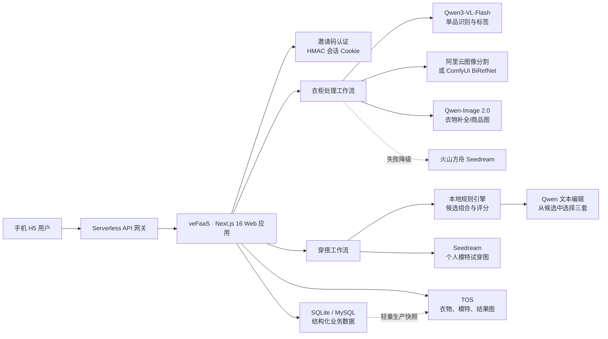

# 衣刻WeMo v2.0：功能、架构与 RAG / Agent 分析

> 本文结论来自代码实现，不以文件名或产品宣传用语作为判断依据。

## 1. 结论摘要

衣刻WeMo是一个面向手机 H5 的 AI 穿搭产品，核心闭环是：邀请码登录 → 上传衣物照片 → 视觉识别与单品拆分 → 生成白底商品图 → 存入个人衣柜 → 规则生成候选搭配 → 大模型编辑选稿 → 生成个人模特试穿图。

当前版本：

- **使用了生成式 AI**：Qwen3-VL-Flash 负责视觉识别与文本编辑，Qwen-Image 2.0 / Seedream 负责衣物补全、商品图或试穿图，阿里云图像分割或 ComfyUI BiRefNet 负责抠图。
- **没有完整 RAG**：代码中没有文档采集、切片、Embedding、向量索引、相似度检索或把检索结果注入模型上下文的链路。
- **没有完整 Agent**：模型不负责自主拆解目标、选择工具、观察结果并循环执行。业务步骤由 Next.js 路由和前端代码固定编排。
- **存在 AI 工作流与任务状态机**：`ai_tasks` 负责幂等、运行状态和结果缓存，但它是工程任务表，不是 Agent。
- **生产环境是轻量单实例架构**：veFaaS 常驻一个实例，SQLite 位于 `/tmp`，通过 TOS 固定对象快照恢复；图片也保存在 TOS。代码同时预留了 MySQL 模式。

## 2. 整体架构

## 3. 功能是如何实现的

| 用户功能 | 主要实现 | AI / 算法 | 数据落点 |
| --- | --- | --- | --- |
| 邀请码登录 | `app/api/auth/*`、`app/lib/auth.ts` | HMAC 校验邀请码并生成 7 天签名 Cookie | 浏览器 `wemo_session` Cookie；不保存明文邀请码 |
| 多用户隔离 | `owner_id` 贯穿所有查询 | 邀请码经独立密钥稳定映射为 `usr-...` | SQLite / MySQL 各业务表 |
| 上传并识别衣物 | `app/lib/garment-image.ts`、`app/api/wardrobe/analyze/route.ts` | 两次互补视觉识别并行执行；Qwen 主服务，显式配置时可降级方舟 | 识别结果先在前端形成草稿 |
| 单品裁剪与白底图 | `productize` 路由、`aliyun-segmentation.ts`、`comfyui-cutout.ts` | Sharp 裁剪；阿里云分割或 BiRefNet；质量不合格时标记复核 | 缓存及最终图片写入对象存储 |
| 遮挡衣物补全 | `reconstruct` 路由 | Qwen-Image 生成候选，像素与连通区域质量检查；账号/计费故障时可降级 Seedream | 合格商品图进入衣柜 |
| 衣柜管理 | `app/api/wardrobe/route.ts` | 结构化标签标准化，无自主模型循环 | `wardrobe_items` + TOS 图片 |
| 初始衣柜 | `app/api/wardrobe/starter/route.ts` | 静态预置图优先，也支持模型生成并缓存 | 每个用户独立写入衣柜 |
| 个人资料与模特照 | `profile`、`model-profile` 路由 | 普通 CRUD 与图片校验 | `user_profiles`、`model_profiles` + TOS |
| 穿搭推荐 | `outfit-engine.ts`、`outfits/recommend` | 规则生成并评分候选；Qwen 只能在候选中选三套和撰写理由 | `ai_tasks`、`chat_history` |
| 自主搭配点评 | `outfits/review` | 本地颜色/版型/场合/天气评分，再由 Qwen 生成短点评 | 即时返回，可由前端保存历史 |
| 收藏与历史 | `outfits/saved`、`outfits/history` | 无模型 | `saved_outfits`、`chat_history` |
| 模特试穿效果图 | `outfits/visualize` | 读取模特照和衣物图，压缩后调用 Seedream；使用语义哈希缓存 | `ai_tasks` + `outfit-results/...` TOS 对象 |
| 天气 | `app/api/weather/route.ts` | 经纬度映射最近城市，调用天气 API | 仅作为推荐上下文 |

## 4. 四条核心 AI 链路

### 4.1 衣物识别

1. 浏览器把上传照片归一化并压缩。
2. `/api/wardrobe/analyze` 对同一张图发起两次互补视觉识别：一次关注整套服装，一次关注容易漏掉的细节和配饰。
3. 服务端对结果做类别归一、边界框清洗、鞋类和上下装去重、外套遮挡过滤及身份组去重。
4. 返回每件单品的位置、类别、颜色和结构化标签。

这是“多模型调用结果合并 + 确定性后处理”，不是 Agent。

### 4.2 商品图生成

1. 优先从原图按识别框裁剪目标单品。
2. 对无遮挡、结构完整的单品执行图像分割，生成白底商品图。
3. 可选择阿里云分割、ComfyUI BiRefNet，或本地优先、云端回退的 hybrid 模式。
4. 如果衣物被人体或其他单品遮挡，调用图像生成模型补全完整形态。
5. 使用前景比例、完整性和连通区域检查过滤失败结果，再用 Sharp 归一到统一白底商品图。

### 4.3 穿搭推荐

1. 从当前用户衣柜读取最多 240 件可用单品。
2. `outfit-engine.ts` 根据类别层级、颜色、版型、场合、天气、用户资料和风格强度生成并评分候选。
3. 通过 Jaccard 重叠度控制候选多样性。
4. Qwen 仅允许从候选中选择三套、命名并写推荐理由，不能自行新增或替换衣物。
5. 如果模型失败，直接使用规则排序结果，保证核心功能仍可用。

因此，推荐系统本质是“规则召回/排序 + LLM 编辑”，不是向量检索，也不是 Agent。

### 4.4 个人模特试穿

1. 校验用户已上传个人全身照，且所选衣物仍属于该用户。
2. 对模特照和衣物图进行尺寸、质量压缩。
3. 根据用户、模特图版本、衣物图版本、场景、提示词、模型和尺寸计算语义哈希。
4. 命中 TOS 缓存则直接返回；未命中时调用火山方舟 Seedream 生成试穿效果图。
5. 将图片写入 `outfit-results/semantic-v2/...`，并在 `ai_tasks` 中记录状态和结果键。

## 5. 为什么判定没有 RAG

完整 RAG 通常至少需要：知识源采集 → 文档解析/切片 → Embedding → 向量或混合索引 → 按查询检索 → 把检索证据注入模型提示词 → 引用或结果评估。

当前仓库：

- `package.json` 没有 LangChain、LlamaIndex、向量数据库或 Embedding SDK；
- 数据表中没有文档块、向量、知识库或检索日志；
- 模型提示词只使用用户输入、天气、个人资料、衣柜结构化标签和程序预先生成的候选；
- `outfit-engine` 是规则组合与评分，不是向量相似度检索；
- TOS 用于图片和 SQLite 快照，不是知识库。

所以当前结论是：**没有搭建 RAG**。如果未来加入流行趋势、品牌知识、体型指南或穿搭知识库，并希望回答时检索引用，才适合引入 RAG。

## 6. 为什么判定没有完整 Agent

完整 Agent 的关键不是调用了大模型，而是模型能够在目标驱动下自主选择工具、读取执行结果、更新计划并进行多轮循环，通常还包含工具协议、运行状态、停止条件和权限边界。

当前仓库：

- API 路由决定下一步调用哪个模型或服务；
- Qwen 在推荐中被严格限制为“从既有候选中选三套”；
- 识别、分割、补全、评分和试穿的顺序写死在代码中；
- 没有模型工具调用协议、动态工具选择、规划器或观察—行动循环；
- `ai_tasks` 只保存 `pending/running/succeeded/failed`、幂等键和结果，不包含 Agent 的计划、工具轨迹或多轮状态。

所以当前更准确的称呼是：**AI 工作流应用 / 多模型编排应用**，而不是完整 Agent。仓库中的《AI Agent 产品上线部署手册》是通用部署资料，文件名本身不能证明产品实现了 Agent。

## 7. 数据与持久化

结构化数据包含六类：

- `wardrobe_items`：衣物、分类、颜色、季节、风格和 AI 标签；
- `model_profiles`：个人模特照对象键；
- `ai_tasks`：推荐与试穿任务状态；
- `saved_outfits`：收藏搭配；
- `chat_history`：推荐历史；
- `user_profiles`：昵称、性别、身高、体重、体型和风格偏好。

本地开发使用 `.data/wemo.sqlite` 与 `.data/objects/`。生产轻量模式使用 `/tmp/data/wemo.sqlite`，图片和 `db_backup/wemo.sqlite` 快照存入 TOS；如果配置 `MYSQL_HOST`，结构化数据切换到 MySQL。

## 8. 登录与安全边界

- 邀请码只从部署环境变量读取，不写入数据库；
- 使用定时安全比较校验邀请码；
- 邀请码通过 `OWNER_ID_SECRET` 映射成稳定用户 ID；
- 会话由不同的 `SESSION_SECRET` 进行 HMAC 签名，有效期 7 天；
- 所有衣柜、模特、历史和收藏查询均带 `owner_id` 条件；
- 生产缺少邀请码或密钥时拒绝服务，不降级成匿名访问；
- TOS 生产访问支持 veFaaS 请求级短期 STS，不要求在仓库或镜像保存长期 AK/SK。

## 9. 部署架构与约束

- Next.js 以 standalone 容器运行，入口 `node server.js`，端口 `8000`；
- 容器部署到火山引擎 veFaaS，API 网关提供 HTTPS 入口；
- 当前 SQLite 模式要求 `min=1`、`max=1` 且版本流量 100% 全量切换，避免多个本地 SQLite 副本同时写入；
- 每次写入约 10 秒后触发防抖快照，每 5 分钟补偿检查；设计 RPO 约 5 分钟，并非零丢失；
- 数据库接近 200 MB、需要多实例或灰度发布时，应迁移到 MySQL。

## 10. 当前优势与主要风险

### 优势

- 功能闭环完整：识别、商品图、衣柜、推荐、收藏、点评和试穿均有对应实现；
- 模型失败时存在规则或备用供应商降级；
- 用户隔离、幂等任务、缓存、超时、质量检查和日志策略比较完整；
- 本地零数据库依赖，生产又预留 MySQL 扩展路径。

### 风险与限制

- 单实例 SQLite 是早期方案，无法安全水平扩容，发布和实例重建依赖 TOS 快照恢复；
- `min=1` 会持续产生预留实例费用，但改为 0 会增加冷启动并破坏当前 `/tmp` SQLite 常驻假设；
- 识别、分割、商品图和试穿依赖多个外部模型服务，账号欠费、配额或密钥失效会影响部分功能；
- 规则引擎可解释、稳定，但还没有基于真实用户反馈训练排序模型；
- 没有 RAG，无法从外部穿搭知识库检索并提供出处；
- 没有 Agent，复杂目标仍由固定页面和接口流程完成；
- 源代码仓库当前没有开源许可证，公开可见不等于第三方自动获得复用或商用授权。

## 11. 如果未来要升级成 RAG 或 Agent

### RAG 方向

可把经过授权的穿搭指南、面料知识、场合规范、品牌尺码和趋势内容建立知识库，并增加：来源管理、切片、Embedding、向量/关键词混合检索、重排、引用展示和离线评测。用户私人衣柜仍建议走结构化 SQL，不必强行向量化。

### Agent 方向

可以定义只读衣柜查询、天气查询、候选生成、效果图生成和保存搭配等受控工具，让模型根据用户目标选择工具。但必须限制可写操作、调用预算和循环次数；删除衣物、修改账号或产生高额模型费用的操作需要用户再次确认。

## 12. 线上体验

网站采用邀请码登录。如需试用，请添加微信 `CZM17882365794` 获取邀请码，添加时请备注「衣刻WeMo 试用」。
